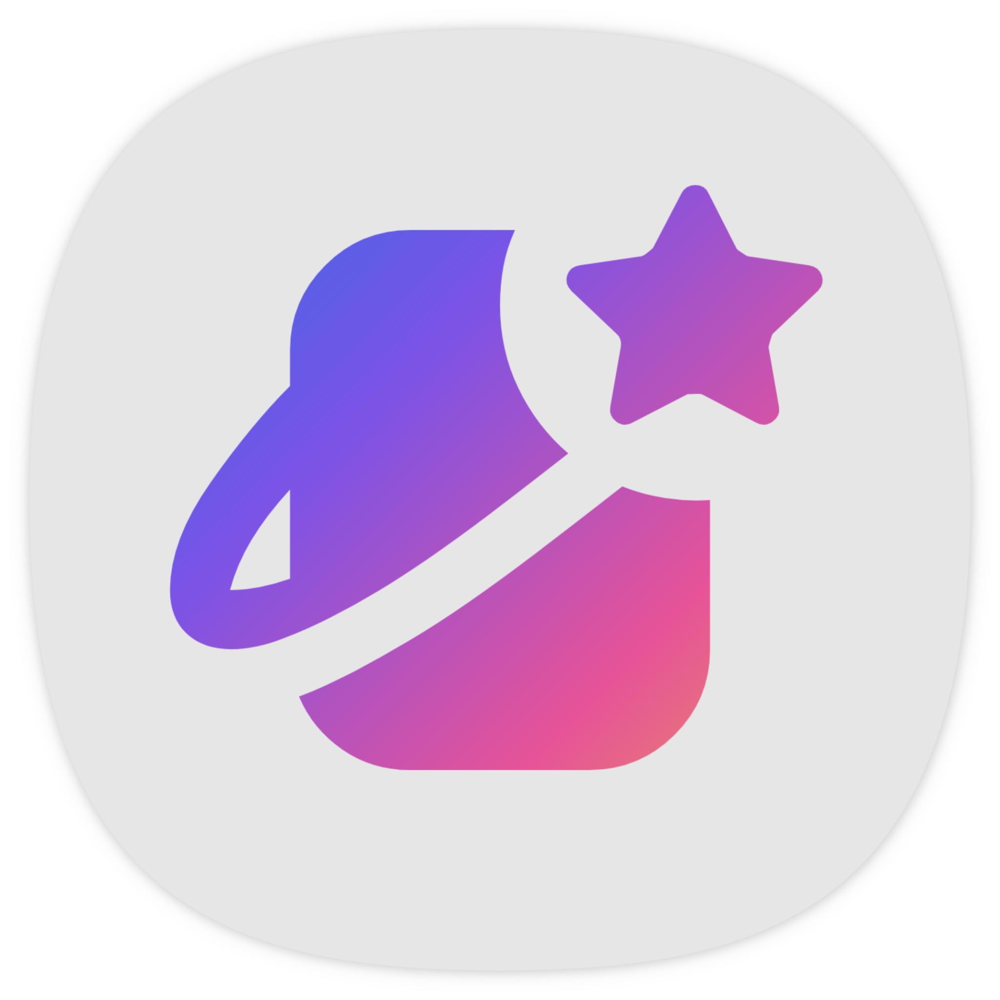
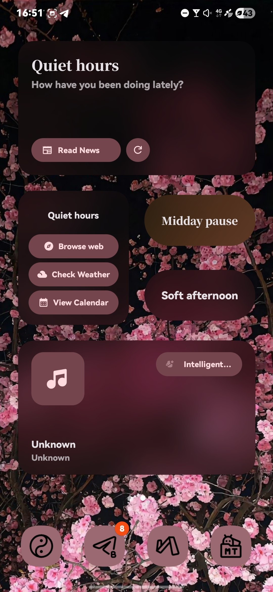
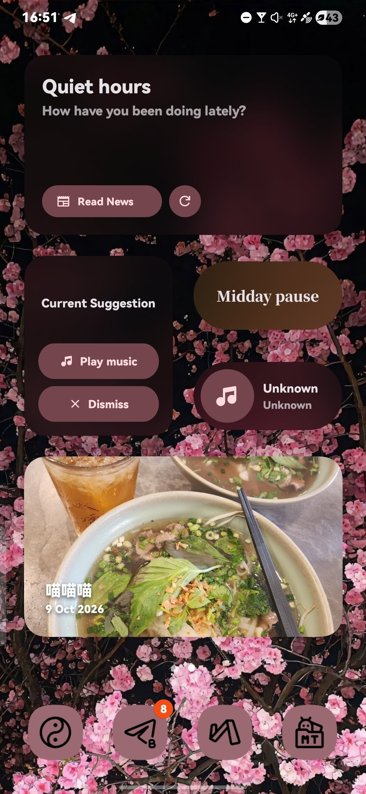
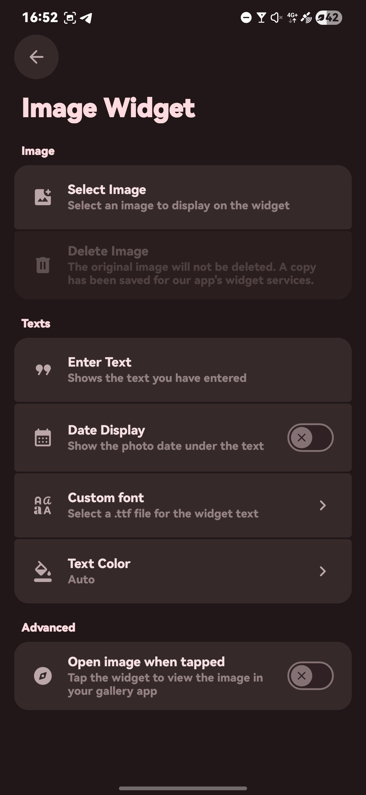
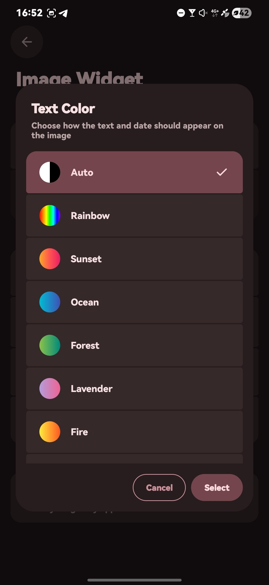
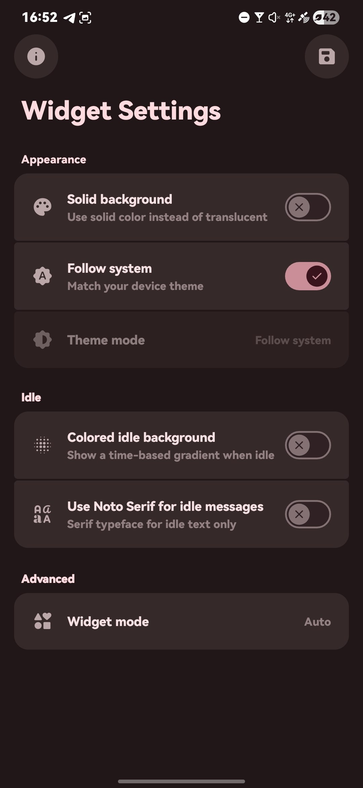
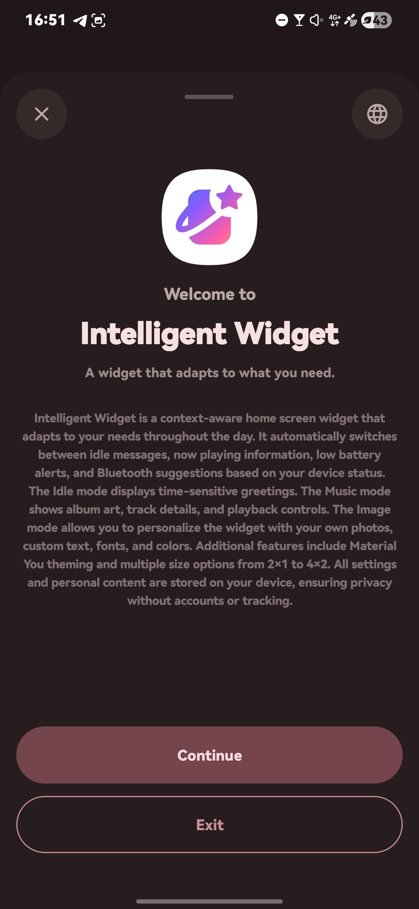
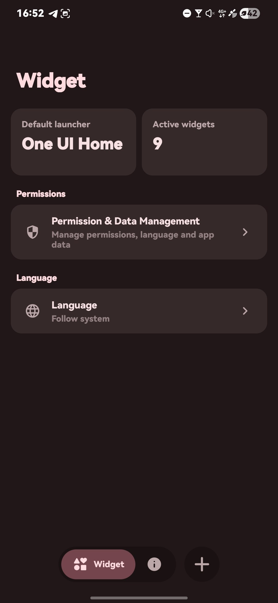
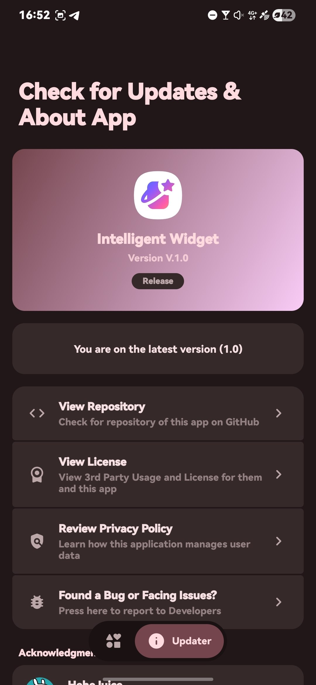

[English](README.md) · **繁體中文**

---

# 智能小工具

> 適用於 `One UI 7 或更新版本`

> 一個隨你所需而變化的小工具

## 功能

> 🎶 顯示正在播放的媒體

> 🖼️ 圖片小工具 —— 可自訂圖片、文字、日期及字型

> 🪫 低電量提醒

> ⚡ 充電指示（待機模式，4×2）

> 🔵 藍牙音樂建議

> 📅 依時間變化的待機操作（日曆、新聞、鬧鐘、模式、天氣）

> 🎨 Material 3 動態色彩（Monet）

> 🌈 依時間變化的待機漸層背景

> ⚙️ 小工具模式 —— 自動 / 待機 / 音樂 / 圖片

## 小工具尺寸

> 2×1、3×1、4×1（另有精簡版）

> 2×2、4×2

## 螢幕截圖

  
  
  
  

  
  
  
  

## 下載

請前往 [Releases 頁面](https://github.com/HeheJuice/Intelligent-Widget/releases) 下載最新 APK。

本應用程式僅以編譯後的 APK 形式發佈，並不提供原始碼。

## 授權與私隱

> [授權條款（EULA）](LICENSE)
>
> [私隱政策](Privacy_Policy.txt)

> [!NOTE]
> 在使用或者轉發過程中必須同意並遵守

## 致謝

<table>
  <tbody>
    <tr>
      <td width="56" align="center" valign="middle">
        
      </td>
      <td valign="middle">
        <a href="https://github.com/HeheJuice"><b>HeheJuice</b></a> 
        本應用程式的開發者
      </td>
    </tr>
    <tr>
      <td width="56" align="center" valign="middle">
        
      </td>
      <td valign="middle">
        <a href="https://github.com/MiToverG422"><b>MiToverG422</b></a> 
        Monet 取色功能協助
      </td>
    </tr>
    <tr>
      <td width="56" align="center" valign="middle">
        
      </td>
      <td valign="middle">
        <a href="https://github.com/material-components"><b>Material Components</b></a> 
        本應用程式使用的 Material 元件
      </td>
    </tr>
    <tr>
      <td width="56" align="center" valign="middle">
        
      </td>
      <td valign="middle">
        <a href="https://github.com/google"><b>Google</b></a> 
        本應用程式使用的 Material Design 圖示
      </td>
    </tr>
    <tr>
      <td width="56" align="center" valign="middle">
        
      </td>
      <td valign="middle">
        <a href="https://github.com/notofonts"><b>Noto Fonts</b></a> 
        本應用程式使用的字型
      </td>
    </tr>
  </tbody>
</table>

## 和我們聊聊天吧
